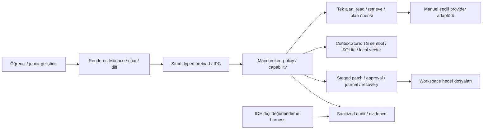

# Sistem mimarisi ve uygulama sözleşmesi

4 Kasım 2026 teknik baz çizgisi. Ürün kapsamı [PRODUCT_PLAN](PRODUCT_PLAN.md), detaylı capability/limit/slice
kararları [IMPLEMENTATION_BASELINE](docs/IMPLEMENTATION_BASELINE.md), apply/approval/recovery protokolü
[CHANGE_LIFECYCLE_CONTRACT](docs/CHANGE_LIFECYCLE_CONTRACT.md) kaynağındadır. Bu tasarım uygulanmış değildir.
Önceki seçenek/metrik/18 ay kopyası [arşivdedir](working-notes/planning-2026-11-04/ARCHIVE_SYSTEM_OPTIONS.md).

## 1. Bileşen ve yetki sınırı

Renderer/model girdisi güvenilmezdir. Main sender, DTO ve işlem capability'sini doğrular; generic fs/shell/IPC erişimi
yoktur. API key yalnız OS-backed store'dan main provider adaptöründe çözülür; config referans tutar. İnsan editör
kaydı ile agent apply ayrı çağrılardır; ikisi de workspace/protected policy'sini uygular.

## 2. Tek ajan ve dosya değişikliği

1. Kullanıcı run başlatır; seçilen provider/privacy/requirements/prompt/policy sürümleri immutable snapshot olur.
2. Aktif dosya, TS import/export ve top-5 retrieval mandatory ignore/protected filtrelerinden sonra contexte girer.
3. Ajan yalnız read/list/search/retrieve/propose_change çağrısı üretir; bilinmeyen veya yarım tool çıktısı reddedilir.
4. Plan v2 ve kesin bayt hashlerine sahip staged patch hazırlanır. Dirty buffer, stale disk ve linked grup kapsamı kontrol edilir.
5. Boundary/protected/secret-in-diff blokları kaldırılamaz. >20 dosya VEYA >500 changed line large-edit uyarısı ayrı zorunlu karardır.
6. İnsan final diff'i onaylar; 10 dakikalık approval workspace/patch/fingerprint/kapsama bağlıdır. Revizyon/seçim değişirse yeni approval gerekir.
7. Broker durable journal/backup'ı hazırlayıp preflight'i tekrarlar; hedefleri tek tek değiştirip post-hash/commit kaydını doğrular.
8. Hata/kesintide recovery tamamlanır veya açık recovery-required oluşur; yeni write durur. Kısmi işlem başarı diye raporlanmaz.
9. Son 10 committed set geri alınabilir; post-hash değişmişse rollback durur ve kullanıcı düzenlemesini ezmez.

Tek dosya replace/rename bütün set için OS atomikliği değildir. Kötü niyetli eşzamanlı yerel süreçlere tam OS sandbox
garantisi verilmez. Hardlink/reparse/handle ve crash davranışı demo OS güvenlik testlerinin konusudur.

## 3. Context, provider ve state sahipliği

ContextStore SQLite/sqlite-vec arkasında bir adaptördür; lexical başlangıç ve native-modül fallback'leri ayrı policy
sürümüyle kaydedilir. Watcher yalnız indeks günceller, otonom AI analizi başlatmaz. Sırlar, .git, build bağımlılıkları,
uygulama state'i, staging/backup/audit hiçbir read/index/pinned-source yolu üzerinden modele açılmaz.

Bir Anthropic ve bir loopback Ollama adaptörü; yeni kurulum local-only. Sağlayıcı değişimi yeni run'dır; otomatik
router/cloud fallback yoktur. Retry/cancel/usage/budget sözleşmesi [teknoloji planındadır](TECH_STACK_AND_AI.md).

Workspace hedefleri kullanıcı kodudur. Main broker'ın opaque workspace-ID state alanı index, audit ve journal
deposudur; model/rendererin dosya yolu vererek erişebileceği ikinci workspace değildir.
[Retention](docs/DATA_RETENTION.md) son 10 seti ve çözümlenmemiş recovery'yi clear/expiry'den korur.

## 4. Verification ve veri sözleşmeleri

[v2 şemalar](docs/schemas/README.md): plan, patch-set, approval, transaction, evidence ve audit; dış koşu sonuçları
benchmark-run schema'sı. v1 geçmiş kaydı yeni write'a yetki vermez. Model/requirement/prompt/policy sürümleri,
run/patch/transaction ID'leri ve exact hashler delilleri aynı değişikliğe bağlar.

Deterministik guard pass ve insan onayı kod doğruluğunun kanıtı değildir. Kabul testleri/rubrik sonuçları dış
harness'ten gelir; başka patch'e ait evidence stale, çalıştırılmayan test not-run olur. İkinci model verifier MVP
dışıdır; farklı prompt/model bağımsız oracle garantisi sayılmaz.

## 5. Araştırma ve teslim sınırı

A external/manual workflow; B disposable fixture capability'siyle genel approval gate kapalı; C gerçek insan kararlı
tam akıştır. B/C mandatory safety/journal aynı; ana yazma görevleri large-edit eşiği altındadır. Q&A read-only'dır.
A/C toplam workflow; B/C kontrol edilmiş bileşen etkisini hedefler. Metot/model/task/fixture freeze ve insan-veri
kararı danışmandan önce olmuş gibi kabul edilmez. Kaynak: [EVALUATION_PROTOCOL](docs/EVALUATION_PROTOCOL.md).

S1 güvenli shell/pure policy, S2 read-only context/providers, S3 tek dosya recovery, S4 çok dosya/partial approval,
S5 formal araştırma, S6 teslim. [Readiness](docs/IMPLEMENTATION_READINESS.md) ve [ADR-011](docs/adr/ADR-011-staged-implementation-and-versioned-contracts.md)
kapıları tanımlar. Güncel source-first dağıtım [paketleme planındadır](DEPLOYMENT_AND_PACKAGING.md).
